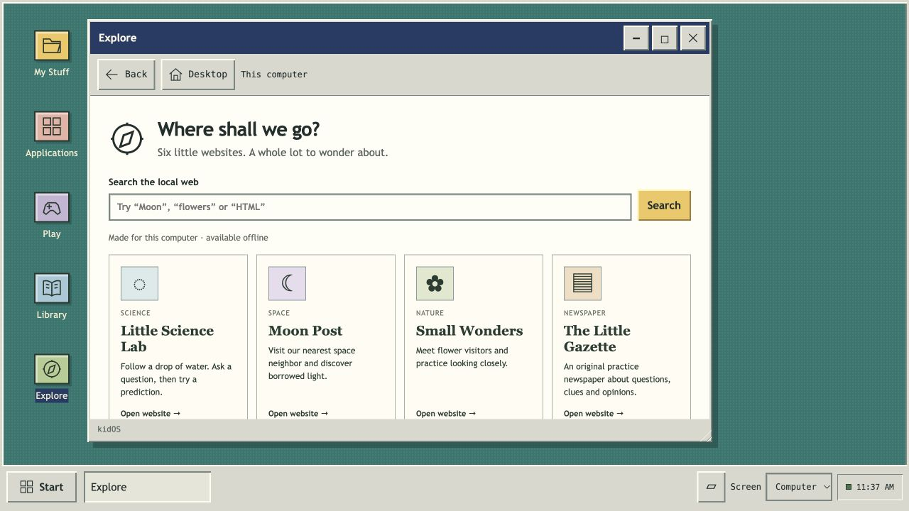

# kidOS

A local-first personal computer for children, with the simplicity of a Windows 95-inspired desktop: ordinary windows, files, creative tools and games. It runs on Linux and works offline after setup, without a cloud account.

**Developer Preview.** kidOS is for supervised experimentation. It is not yet a hardened child appliance. An experimental amd64 USB image has passed emulated boot, drive-preservation, installation and document-persistence checks; physical Raspberry Pi/PC qualification, parent authentication, OS-level child-code containment, complete onboarding and secure device updates are unfinished.

[Download USB and previews](https://github.com/slapper-commits/kidOS/releases/tag/v0.0.1-pilot.20) · [All install options](docs/INSTALL.md) · [Report a bug](https://github.com/slapper-commits/kidOS/issues) · [Contribute](CONTRIBUTING.md) · [Roadmap](docs/ROADMAP.md)



*Browser preview with empty local data and original built-in lessons. Native Linux apps are configured separately.*

## What works today

- A familiar desktop, Start menu and taskbar; movable, resizable browser windows and saved workspace arrangements.
- Computer, tablet and TV layouts. Touch and controller acceptance remain pending.
- My Stuff, Code Editor and Applications: create, edit, export, import and install local HTML/CSS/JavaScript projects, with recoverable Trash and editor drafts.
- Two original remixable games, plus a separately provisioned native app catalog for Write (LibreOffice Writer), Paint, Calculator, Files, OpenTTD, Solitaire, Minesweeper, Pinball and Puzzle Box.
- A local Library for supported audio, video, photos, text, PDF and EPUB chapter text. Bring your own permitted content; no household media is bundled.
- Explore: six original offline educational websites with real local HTTP forms, search and request inspection.
- Mailbox: local letters between named mailboxes on one computer. These are shared labels, not authenticated accounts or internet email.

Native apps require the Linux session setup; they do not run inside the browser preview. Native windows are not yet fully integrated with the browser taskbar. The educational sites do not establish a filtered public internet, and browser sandboxing is not OS containment. Use trusted local projects only.

## Try the desktop locally

Install Node.js 22 or 24 and use a modern browser. No npm packages need to be downloaded.

```sh
git clone https://github.com/slapper-commits/kidOS.git
cd kidOS
npm test
npm start
```

Open **http://127.0.0.1:8787**. The desktop and app runner bind only to loopback, on ports 8787 and 8788. Stop both with Ctrl+C. To use another private data directory or different ports:

```sh
KIDOS_DATA_DIR="$HOME/kidos-data" KIDOS_PORT=8787 KIDOS_RUNNER_PORT=8788 npm start
```

By default, projects, media, local letters and workspace state live in `.data/` beside the source. Keep it when changing source versions. Native files and game saves live separately in the Linux desktop user's home. Stop the service before backing up its complete data directory; also back up native files. Project export is not a whole-device backup. Read [migration and recovery limits](docs/ARCHITECTURE.md#storage-and-recovery) before downgrading.

## Choose how to try or install

| What you want | Download or guide | Current scope |
| --- | --- | --- |
| Try without installing | [USB preview and instructions](docs/USB-TRY.md) · [Downloads](https://github.com/slapper-commits/kidOS/releases/tag/v0.0.1-pilot.20) | Linux, kidOS and native apps included. Temporary session; files/settings live in RAM. |
| Make a dedicated kidOS computer | [Optional USB installation](docs/USB-TRY.md#optional-installation) | Separate graphical installer with explicit drive selection. Installation can erase the selected drive. |
| Add kidOS to a Debian PC | [Debian 13 amd64 setup](os/linux-pc/README.md) | Guarded developer installer; Debian must already be installed. |
| Use a Raspberry Pi | [Pi developer setup](os/raspberry-pi/README.md) | Pi 5 / 8 GB, Raspberry Pi OS Trixie 64-bit Desktop. Physical acceptance pending; no Pi image. |
| Keep macOS, Windows or Linux | [Source browser preview](#try-the-desktop-locally) | Compatible Node.js 22/24 host and modern browser; native Linux apps unavailable. |
| Develop in a Linux VM | [Debian ARM64 QEMU fixture](os/linux-test/README.md) | Developer setup for Apple Silicon macOS; not a family appliance. |
| Install a native macOS/Windows app | [Planned existing-OS editions](docs/INSTALL.md#planned-existing-os-applications) | No kidOS `.dmg`, `.exe` or `.msi` yet. |

**Start with the [USB guide](docs/USB-TRY.md) to let a friend try kidOS.** Download both ISO parts from [pilot.20](https://github.com/slapper-commits/kidOS/releases/tag/v0.0.1-pilot.20), combine them using the macOS or Windows instructions, verify the complete ISO and flash an empty removable USB stick. Flashing erases that USB. Choose **Try kidOS** to use a temporary session without selecting an internal drive. Shut down and remove the USB to return to the existing OS. Export trial creations before shutdown; they are not automatically kept or transferred during installation.

Provisional USB targets are 64-bit Intel/AMD PCs and Intel MacBooks from 2012–2017 without T2. Start with 4 GB RAM; 8 GB is preferable. Apple Silicon, T2 Macs, ARM Windows devices and 32-bit PCs are outside this preview. A model year alone does not establish compatibility. Physical graphics, Wi-Fi, audio, input, suspend, USB copy/eject and Secure Boot remain unqualified.

Emulated BIOS/UEFI trial, full synthetic Try/Cancel drive preservation, offline UEFI installation and two installed boots passed. The first page needed **Ctrl+R**; native-app buttons also timed out. A saved document reopened through the Linux Documents folder after the second boot's kidOS Write shortcut timed out. Read the [tested workarounds](docs/USB-TRY.md#try-save-and-leave) and [verification scope](docs/USB-VERIFICATION.md).

The release contains the unchanged verified frozen pilot.19 USB system alongside the newer `kidos-0.0.1-pilot.20.tar` portable source bundle. The portable bundle includes guarded Pi/PC installers and `RELEASE.json`, without Linux, Node.js or native application binaries. GitHub's automatic source ZIP/tar downloads contain the full checkout and cannot replace that bundle or the USB's matching package sources. See [all install options](docs/INSTALL.md) for the route details.

The [rollout plan](docs/PC-INSTALL.md) separates installer code, physical qualification and independent friend trials. CI and VM tests do not certify hardware, child containment or parent controls.

## Updates

Previews are **manual and optional**. Watch this repository → Custom → Releases to receive GitHub notifications, then choose whether to download a newer version. No background updater or forced restart is included. Check release notes and back up creations before installing.

A parent-authorized, signed update system with tested recovery is [planned](docs/UPDATES.md). Checksums alone do not authenticate a publisher. See [release procedures](docs/RELEASING.md) and [requirements before gifting a device](docs/GIFTABLE.md).

## Project guide

[Product](docs/PRODUCT.md) · [Architecture](docs/ARCHITECTURE.md) · [Native apps](docs/NATIVE-APPS.md) · [Library](docs/LIBRARY.md) · [Explore](docs/EXPLORE.md) · [Mailbox](docs/MAILBOX.md) · [App contract](packages/app-contract/README.md) · [Security](SECURITY.md)

Original kidOS code, artwork and documentation are [MIT licensed](LICENSE). Bundled reader libraries and separately installed Linux packages retain their own licenses. See [provenance and third-party notices](docs/PROVENANCE.md). The USB delivery includes matching package sources, its frozen recipe and notices; physical hardware acceptance remains separate work.
